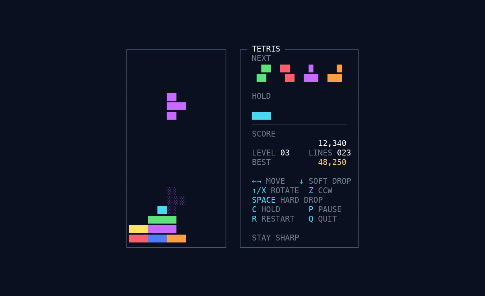

# Tetris TUI

A polished, dependency-free Tetris game for the terminal. Seven-bag pieces, SRS wall kicks, hold, ghost piece, four-piece preview, lock delay, combos, persistent high score, and a responsive curses interface.



## Play

Requires Python 3.11+ and a UTF-8 terminal.

```sh
python3 -m tetris
```

That's it. There is nothing to install and no virtual environment to create.

## Controls

| Key                | Action                    |
| ------------------ | ------------------------- |
| `←` `→` or `A` `D` | Move                      |
| `↓` or `S`         | Soft drop                 |
| `↑`, `X`, or `W`   | Rotate clockwise          |
| `Z`                | Rotate counter-clockwise  |
| `Space`            | Hard drop                 |
| `C`                | Hold / swap               |
| `P` or `Esc`       | Pause / resume            |
| `Enter`            | Start, resume, or restart |
| `R`                | Restart                   |
| `Q`                | Quit                      |

The game needs at least **50 × 22** terminal cells. If the window is resized too small, the action pauses until there is room again.

## Rules

- Board is 10 × 20.
- Pieces use SRS rotation with wall kicks.
- Seven-bag randomizer: every seven pieces contains each tetromino once.
- Hold can be used once per piece.
- Soft drop awards 1 point per cell; hard drop awards 2.
- Line clears award `100 / 300 / 500 / 800` points times the current level for 1 / 2 / 3 / 4 lines.
- Consecutive clears add a combo bonus of `50 × combo × level`.
- Level rises every 10 lines. Gravity starts at 850 ms and accelerates by 15% per level, down to an 80 ms floor.
- A landed piece locks after 500 ms. Successful movement can reset that timer up to 15 times.

## High score

Scores are saved after a game ends, or when you quit or restart a run with a new best.

```text
$XDG_STATE_HOME/tetris-tui/highscore.json
```

When `XDG_STATE_HOME` is unset, the file lives at `~/.local/state/tetris-tui/highscore.json`. A missing or malformed score file is treated as zero and repaired on the next save.

## Development

Run the full headless suite:

```sh
python3 -m unittest discover -s tests -v
```

The code is split at real boundaries:

- `tetris.engine` owns the rules and is deterministic when given an injected piece source.
- `tetris.controller` owns the menu/play/pause/game-over state machine and high-score updates.
- `tetris.ui` composes a style-tagged `Canvas`, so every screen can be snapshot-tested without a terminal.
- `tetris.app` is a thin curses adapter for colors, input translation, resize handling, and painting.
- `tetris.scores` is the filesystem adapter, with an injectable path and atomic writes.

The game has no third-party runtime dependencies. Test dependencies are the Python standard library only.
